# Career Compass — UML Class Diagram & Architecture

This document provides the UML Class Diagram illustrating the Object-Oriented design of **Career Compass**, showcasing the implementation of the four core OOP pillars: **Encapsulation**, **Inheritance**, **Abstraction**, and **Polymorphism**.

---

## 1. UML Class Diagram (Mermaid)

```mermaid
classDiagram
    direction TB

    %% ==========================================
    %% ABSTRACTION & POLYMORPHISM (Scoring Layer)
    %% ==========================================
    class ScoringStrategy {
        <<interface>>
        +calculateScores(List~Response~ responses, List~Question~ questions) Map~Dimension, TraitScore~
        +getStrategyName() String
    }

    class LikertScoringStrategy {
        +int QUESTIONS_PER_DIMENSION
        +int MIN_RAW_SCORE
        +int MAX_RAW_SCORE
        +calculateScores(List~Response~ responses, List~Question~ questions) Map~Dimension, TraitScore~
        +normalizeScore(int rawScore) int
        +getStrategyName() String
    }
    ScoringStrategy <|.. LikertScoringStrategy : implements (Polymorphism)

    class ScoreCalculator {
        -ScoringStrategy scoringStrategy
        +ScoreCalculator(ScoringStrategy scoringStrategy)
        +computeTraitScores(List~Response~ responses, List~Question~ questions) List~TraitScore~
    }
    ScoreCalculator o--> ScoringStrategy : depends on Abstraction

    %% ==========================================
    %% INHERITANCE (Question Hierarchy)
    %% ==========================================
    class Question {
        <<abstract>>
        -Long id
        -String questionText
        -Dimension dimension
        -int displayOrder
        +getId() Long
        +getQuestionText() String
        +getDimension() Dimension
        +getDisplayOrder() int
        +getQuestionType()* String
    }

    class LikertQuestion {
        -int scaleMin
        -int scaleMax
        -String minLabel
        -String maxLabel
        +getQuestionType() String
        +getScaleMin() int
        +getScaleMax() int
    }
    Question <|-- LikertQuestion : inherits (Inheritance)

    class ScenarioQuestion {
        -String scenarioContext
        -int optionCount
        +getQuestionType() String
        +getScenarioContext() String
        +getOptionCount() int
    }
    Question <|-- ScenarioQuestion : inherits (Extensibility)

    %% ==========================================
    %% ENCAPSULATION & DATA MODELS
    %% ==========================================
    class Dimension {
        <<enumeration>>
        ANALYTICAL_THINKING
        CREATIVITY
        SOCIAL_ORIENTATION
        LEADERSHIP_AND_INITIATIVE
        PRACTICAL_HANDS_ON
        +getDisplayName() String
        +getDescription() String
    }

    class Student {
        -String name
        -String educationLevel
        +Student(String name, String educationLevel)
        +getName() String
        +setName(String name)
        +getEducationLevel() String
        +setEducationLevel(String educationLevel)
    }

    class Response {
        -Long questionId
        -int rating
        +Response(Long questionId, int rating)
        +getQuestionId() Long
        +setQuestionId(Long questionId)
        +getRating() int
        +setRating(int rating)
    }

    class TraitScore {
        -Dimension dimension
        -int rawScore
        -int normalizedScore
        +TraitScore(Dimension dimension, int rawScore, int normalizedScore)
        +getDimension() Dimension
        +getRawScore() int
        +getNormalizedScore() int
    }

    class CareerProfile {
        -Long id
        -String careerName
        -String description
        -String relevantSkills
        -String matchingExplanation
        -String learningActivities
        -int weightAnalytical
        -int weightCreativity
        -int weightSocial
        -int weightLeadership
        -int weightPractical
        +getWeightForDimension(Dimension dimension) int
        +getTotalWeight() int
    }

    class CareerRecommendation {
        -Long careerId
        -String careerName
        -int matchScore
        -int rankOrder
        -String description
        -String relevantSkills
        -String matchingExplanation
        -String learningActivities
        +getMatchScore() int
        +getRankOrder() int
    }

    class AssessmentResult {
        -Long id
        -Student student
        -LocalDateTime createdAt
        -List~Response~ answers
        -List~TraitScore~ traitScores
        -List~CareerRecommendation~ recommendations
        +getStudent() Student
        +getTraitScores() List~TraitScore~
        +getRecommendations() List~CareerRecommendation~
    }
    AssessmentResult *-- Student : embeds (Encapsulation)
    AssessmentResult *-- "15" Response : contains
    AssessmentResult *-- "5" TraitScore : contains
    AssessmentResult *-- "3" CareerRecommendation : contains

    %% ==========================================
    %% SERVICES & RECOMMENDATION ENGINE
    %% ==========================================
    class RecommendationEngine {
        +int TOP_RECOMMENDATIONS_COUNT
        +recommendCareers(List~TraitScore~ traitScores, List~CareerProfile~ careerProfiles) List~CareerRecommendation~
        +calculateCareerMatchScore(List~TraitScore~ traitScores, CareerProfile profile) int
    }

    class AssessmentService {
        -QuestionRepository questionRepository
        -CareerProfileRepository careerProfileRepository
        -AssessmentResultRepository assessmentResultRepository
        -ScoreCalculator scoreCalculator
        -RecommendationEngine recommendationEngine
        +getAllQuestions() List~Question~
        +getAllCareerProfiles() List~CareerProfileDto~
        +submitAssessment(AssessmentSubmissionRequest request) AssessmentResultResponse
        +getAssessmentResultById(Long id) AssessmentResultResponse
    }
    AssessmentService --> ScoreCalculator : uses
    AssessmentService --> RecommendationEngine : uses

    class AssessmentController {
        -AssessmentService assessmentService
        +getQuestions() ResponseEntity
        +submitAssessment(AssessmentSubmissionRequest request) ResponseEntity
        +getCareers() ResponseEntity
        +getAssessmentResult(Long id) ResponseEntity
    }
    AssessmentController --> AssessmentService : delegates
```

---

## 2. Key Architecture Relationships

| Component | Role | OOP Principle Demonstrated |
| :--- | :--- | :--- |
| `Student`, `Response`, `TraitScore` | Domain value models protecting integrity via private fields and validation rules in setters/constructors. | **Encapsulation** |
| `Question` (Abstract Base) $\rightarrow$ `LikertQuestion`, `ScenarioQuestion` | Shared properties (ID, text, dimension) inherited by concrete subtypes; supports future question types. | **Inheritance** |
| `ScoringStrategy` (Interface) | Defines the contract `calculateScores` without exposing mathematical calculation details. | **Abstraction** |
| `ScoreCalculator` invoking `LikertScoringStrategy` through `ScoringStrategy` | High-level calculator depends on the interface reference, invoking the concrete strategy dynamically at runtime. | **Polymorphism** |
| `RecommendationEngine` | Rule-based weighted ranking: $\text{Match Score} = \frac{\sum(\text{Dimension Score} \times \text{Weight})}{\sum \text{Weights}}$. | Deterministic Business Logic |
